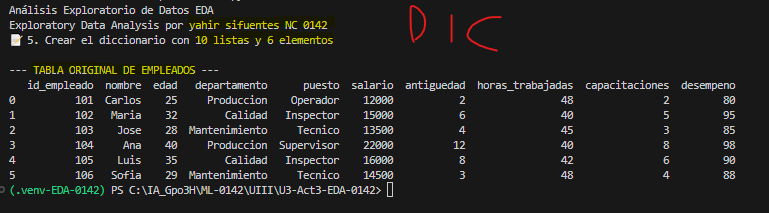
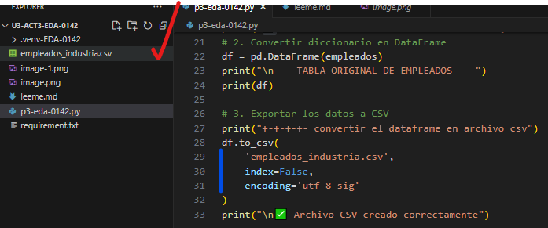
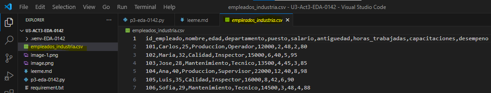

# 📊 UIII Act3: Importación y Descripción de Datos
# yahir sifuentes NC 0142 
> **🎓 Asignatura:** Soluciona problemas de Machine Learning  
> **📚 Nivel:** Tercer semestre de preparatoria  
> **🤖 Especialidad:** Inteligencia Artificial  
> **📈 Dificultad:** Cero a principiante  
> **🐍 Lenguaje:** Python  
> **🛠️ Herramientas:** Visual Studio Code, Pandas, Matplotlib y CSV  
## tabla original de empleados 

## Convertir el DataFrame en archivo CSV

## . Leer los datos desde el archivo CSV
